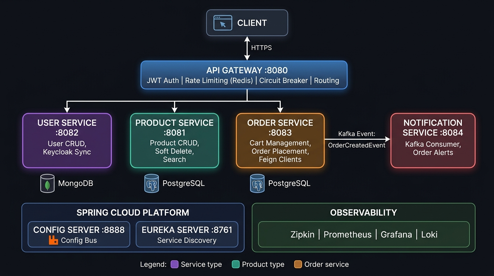
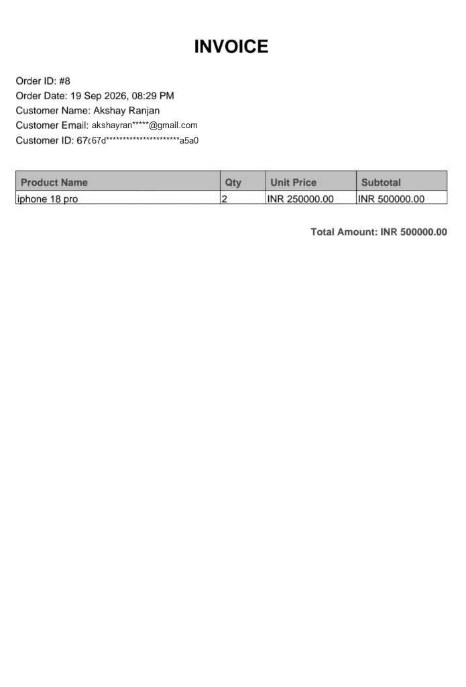
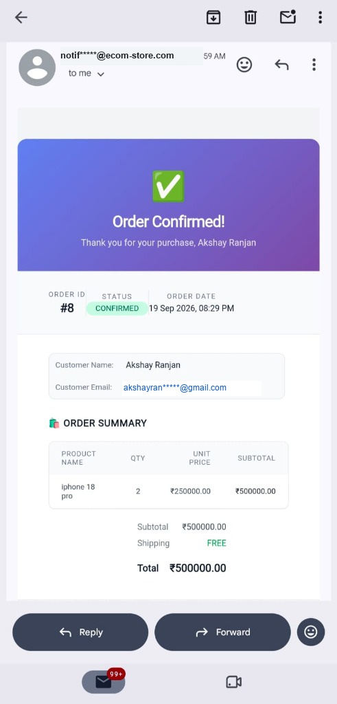

# eCommerce Microservices Platform

A modern, scalable, and event-driven eCommerce backend built with **Java 21**, **Spring Boot 3.4.x**, and **Spring Cloud 2024.0.x**.



---

## 1. Services Overview

| Service | Port | Database / Engine | Description |
|---|---|---|---|
| **API Gateway** | 8080 | Redis | Single entry point: routing, auth filter, rate limiting, circuit breaking |
| **Config Server** | 8888 | - | Centralised configuration with hot-reload via RabbitMQ bus |
| **Eureka Server** | 8761 | - | Service registry and load-balanced discovery |
| **User Service** | 8082 | MongoDB | User registration, profile management, Keycloak identity sync |
| **Product Service** | 8081 | PostgreSQL | Product catalogue with CRUD, soft-delete, and keyword search |
| **Order Service** | 8083 | PostgreSQL | Shopping cart, order placement, Kafka event publishing |
| **Notification Service** | 8084 | - | Asynchronous Kafka event consumer: PDF invoice generator & HTML email sender |

---

## 2. Tech Stack

### Core
* **Java 21** (LTS)
* **Spring Boot 3.4.x**
* **Spring Cloud 2024.0.x**
* **Maven 3.9+**

### Spring Cloud Components
* **Spring Cloud Gateway:** Reactive API gateway with routing filters
* **Spring Cloud Config:** Centralised configuration repository
* **Spring Cloud Netflix Eureka:** Service discovery & registry
* **Spring Cloud Stream (Kafka):** Event-driven messaging for checkout & notifications
* **Spring Cloud Bus (RabbitMQ):** Configuration refresh broadcast
* **Spring Cloud CircuitBreaker (Resilience4j):** Fault tolerance & fallback mechanisms
* **Spring Cloud OpenFeign / RestClient:** Declarative HTTP inter-service communication

### Databases & Messaging
* **PostgreSQL 14:** Relational databases for Product and Order microservices
* **MongoDB:** Document database for User profiles and metadata
* **Redis:** In-memory store for API Gateway rate limiting
* **Apache Kafka:** Event broker (`order.exchange` topic for order notifications)
* **RabbitMQ:** Message broker for Spring Cloud Bus refresh events

### Security & Observability
* **Keycloak 26.2:** OAuth2 / OpenID Connect authentication server (port 8443)
* **Spring Security:** OAuth2 Resource Server JWT validation
* **Zipkin:** Distributed request tracing (port 9411)
* **Prometheus:** Metrics collection and scraping from Spring Boot Actuator (port 9090)
* **Loki (Single-Binary):** Lightweight log aggregation engine with local filesystem storage (port 3100)
* **Promtail:** Docker container log collector and shipper
* **Grafana:** Observability, metrics visualization & live log search dashboard (port 3001)

---

## 3. Step-by-Step Process to Start the Platform

Follow these steps to build and run the entire ecosystem locally.

### Prerequisites
* **Docker Desktop** installed and running with WSL 2 / virtualization enabled
* **Java 21** and **Maven** installed (or use the included `mvnw` / `mvnw.cmd` wrappers)
* **Git** installed

---

### Step 1: Clone the Repository & Verify Directory Structure
```bash
git clone <repo-url>
cd ecom-microservices-1
```

Directory structure:
```text
ecom-microservices-1/
├── configserver/               # Spring Cloud Config Server (port 8888)
├── eureka/                     # Eureka Discovery Server (port 8761)
├── gateway/                    # API Gateway (port 8080)
├── user/                       # User Service (port 8082)
├── product/                    # Product Service (port 8081)
├── order/                      # Order Service (port 8083)
├── notification/               # Notification Service (port 8084)
├── deploy/docker/              # Docker Compose and configuration files
│   ├── docker-compose.yml
│   └── .env                    # Environment variables file
├── sample_invoice.jpg          # Verified test case invoice sample
└── ecom-microservices.postman_collection.json # Ready-to-use Postman test suite
```

---

### Step 2: Configure Environment Variables

Open `deploy/docker/.env` and ensure your database credentials and Gmail SMTP App Password are set:

```env
# PostgreSQL
DB_USER=tejas
DB_PASSWORD=tejas

# MongoDB
MONGO_URI=mongodb://mongo:27017

# RabbitMQ
RABBITMQ_HOST=rabbitmq
RABBITMQ_PORT=5672
RABBITMQ_USERNAME=guest
RABBITMQ_PASSWORD=guest
RABBITMQ_VHOST=/

# Zipkin
ZIPKIN_URL=http://zipkin:9411/api/v2/spans

# pgAdmin
PGADMIN_DEFAULT_EMAIL=tejas@pgadmin.org
PGADMIN_DEFAULT_PASSWORD=tejas

# Notification Service Gmail SMTP Config
EMAIL_USERNAME=your-email@gmail.com
EMAIL_PASSWORD=your-app-password
```

> **Note:** For Gmail SMTP, generate a 16-character App Password under your Google Account Security settings (`App Passwords`).

---

### Step 3: Build the Service JARs

Run Maven package across all microservice directories:

**On Linux/macOS:**
```bash
for dir in configserver eureka gateway product user order notification; do
  (cd $dir && ./mvnw clean package -DskipTests)
done
```

**On Windows (PowerShell):**
```powershell
@("configserver", "eureka", "gateway", "product", "user", "order", "notification") | ForEach-Object {
    Push-Location $_
    .\mvnw.cmd clean package -DskipTests
    Pop-Location
}
```

---

### Step 4: Start All Services via Docker Compose

Navigate to the `deploy/docker` directory and start all containers in detached mode:

```bash
cd deploy/docker
docker compose up -d --build
```

Docker will launch:
1. **Infrastructure**: PostgreSQL, MongoDB, RabbitMQ, ZooKeeper, Kafka, Keycloak
2. **Spring Core**: Eureka, Config Server
3. **Application Microservices**: API Gateway, Product Service, User Service, Order Service, Notification Service
4. **Lightweight Monitoring**: Prometheus (port 9090), Loki (port 3100), Promtail, Grafana (port 3001)

---

### Step 5: Verify System Health & Discovery

1. **Check container status:**
   ```bash
   docker ps
   ```
   All containers should display status `Up`.

2. **Check Eureka Registry (`http://localhost:8761`):**
   Open `http://localhost:8761` in your browser. The following applications should be registered with status `UP`:
   * `GATEWAY-SERVICE`
   * `PRODUCT-SERVICE`
   * `USER-SERVICE`
   * `ORDER-SERVICE`

3. **Check Kafka Consumer Subscription:**
   ```bash
   docker logs --tail 30 notification-service
   ```
   You should see:
   ```text
   Subscribed to topic(s): order.exchange
   notification-group: partitions assigned: [order.exchange-0]
   ```

---

## 4. Verified End-to-End Test Case

Below is the verified test case confirming order placement, dynamic product & customer name resolution, accurate item subtotal & quantity multiplication, PDF invoice generation, and email dispatch.

### Test Screenshot: Generated PDF Invoice


---

### Test Data Used

#### A. Customer Profile (Stored in MongoDB `ecom_user.users`)
```json
{
  "_id": "67d533476a55cf5c8124a5a0",
  "firstName": "Akshay",
  "lastName": "Ranjan",
  "email": "akshayran*****@gmail.com",
  "phone": "+919876543212",
  "role": "CUSTOMER"
}
```

#### B. Product Catalog Item (Created in PostgreSQL via Product API)
* **Endpoint:** `POST http://localhost:8081/api/products`
* **Request Payload:**
```json
{
  "name": "iphone 18 pro",
  "description": "Apple iphone 18 pro flagship",
  "price": 250000.00,
  "stockQuantity": 10,
  "category": "Electronics",
  "imageUrl": "https://placehold.co/600x400"
}
```
* **Response:** Product created with ID `7`, Unit Price `₹250,000.00`.

#### C. Shopping Cart Addition
* **Endpoint:** `POST http://localhost:8083/api/cart`
* **Headers:** `X-User-ID: 67d533476a55cf5c8124a5a0`
* **Payload:**
```json
{
  "productId": "7",
  "quantity": 2
}
```

#### D. Order Placement
* **Endpoint:** `POST http://localhost:8083/api/orders`
* **Headers:** `X-User-ID: 67d533476a55cf5c8124a5a0`
* **Response (Order #8 Confirmed):**
```json
{
  "id": 8,
  "totalAmount": 500000.0,
  "status": "CONFIRMED",
  "items": [
    {
      "id": 8,
      "productId": "7",
      "productName": "iphone 18 pro",
      "quantity": 2,
      "price": 250000.0,
      "subTotal": 500000.0
    }
  ],
  "createdAt": "2026-09-19T20:29:22.510889"
}
```

#### E. Kafka Event Published (`order.exchange`)
```json
{
  "orderId": 8,
  "userId": "67d533476a55cf5c8124a5a0",
  "userEmail": "akshayran*****@gmail.com",
  "userName": "Akshay Ranjan",
  "status": "CONFIRMED",
  "items": [
    {
      "id": 8,
      "productId": "7",
      "productName": "iphone 18 pro",
      "quantity": 2,
      "price": 250000.0,
      "subTotal": 500000.0
    }
  ],
  "totalAmount": 500000.0,
  "createdAt": "2026-09-19T20:29:22.510889"
}
```

#### F. Invoice & Notification Logs Output
```text
INFO --- [notification] [container-0-C-1] c.e.notification.OrderEventConsumer      : Received OrderCreatedEvent — orderId: 8, user: Akshay Ranjan, email: akshayran*****@gmail.com
INFO --- [notification] [container-0-C-1] c.e.notification.service.InvoiceService  : Generating invoice for order: 8
INFO --- [notification] [container-0-C-1] c.e.notification.service.EmailService    : Order confirmation email sent to: akshayran*****@gmail.com for order: 8
```

#### G. Invoice Document Breakdown
* **File Name:** `Invoice_Order_8.pdf`
* **Order ID:** `#8`
* **Order Date:** `19 Sep 2026, 08:29 PM`
* **Customer Name:** `Akshay Ranjan`
* **Customer Email:** `akshayran*****@gmail.com`
* **Customer ID:** `67d533476a55cf5c8124a5a0`
* **Items Table:**
  * **Product Name:** `iphone 18 pro`
  * **Qty:** `2`
  * **Unit Price:** `INR 250000.00`
  * **Subtotal:** `INR 500000.00`
* **Total Amount:** `INR 500000.00`

#### H. Order Verification Screenshots

| 📄 Generated PDF Invoice | 📧 Gmail Order Confirmation |
|:---:|:---:|
|  |  |

---

## 5. API Reference & Testing with Postman

The complete Postman collection is located at the root of the project:
`ecom-microservices.postman_collection.json`

Import it into Postman to test all endpoints through the API Gateway (`http://localhost:8080`):

### Authentication (Keycloak)
* `POST http://localhost:8080/realms/ecom-realm/protocol/openid-connect/token`
  * Form Data: `client_id`, `username`, `password`, `grant_type=password`

### User Service (`/api/users`)
* `POST /api/users` — Register a new user
* `GET /api/users/{id}` — Get user details by ID
* `PUT /api/users/{id}` — Update user profile
* `DELETE /api/users/{id}` — Delete user

### Product Service (`/api/products`)
* `GET /api/products` — List all products
* `GET /api/products/{id}` — Get product by ID
* `POST /api/products` — Create a new product
* `PUT /api/products/{id}` — Update product
* `DELETE /api/products/{id}` — Soft delete product
* `GET /api/products/search?keyword={kw}` — Search products by keyword

### Cart & Order Service (`/api/cart` and `/api/orders`)
* `GET /api/cart` — View current user's cart (Header: `X-User-ID: {userId}`)
* `POST /api/cart` — Add item to cart (Body: `productId`, `quantity`)
* `DELETE /api/cart/{productId}` — Remove item from cart
* `DELETE /api/cart` — Clear entire cart
* `POST /api/orders` — Place order and trigger asynchronous Kafka notification

---

## 6. Access URLs & Default Credentials

| Service | Username | Password | Access URL | Purpose |
|---|---|---|---|---|
| **Frontend Storefront** | - | - | http://localhost:3000 | React 19 + Vite eCommerce Storefront |
| **Grafana Dashboard** | admin | admin | http://localhost:3001 | Observability, Metrics & Live Log Search |
| **Prometheus** | - | - | http://localhost:9090 | Time-series metrics collection & scraping |
| **Loki Engine** | - | - | http://localhost:3100 | Single-binary log storage API |
| **Zipkin Tracing** | - | - | http://localhost:9411 | Distributed inter-service request tracing |
| **Eureka Dashboard** | - | - | http://localhost:8761 | Service Discovery & Registry health |
| **Keycloak Admin** | admin | admin | http://localhost:8443 | OAuth2 / OpenID Connect Identity Management |
| **RabbitMQ Management** | guest | guest | http://localhost:15672 | Message broker queue & exchange monitor |
| **PostgreSQL** | tejas | tejas | localhost:5432 | Relational database (Product & Order services) |

> **Note on Storage Optimization:** The previous 10-container monitoring stack (distributed Loki read/write, MinIO S3 simulation, Alloy, pgAdmin, and mock log generator) was streamlined into a single-binary setup, reclaiming **~11.2 GB** of disk space while keeping 100% of metrics and log search capabilities. The full enterprise monitoring file remains preserved at [`deploy/docker/docker-compose-with-monitoring.yml`](file:///deploy/docker/docker-compose-with-monitoring.yml) for reference.

---

## 7. Fault Tolerance & Resilience

* **Circuit Breaker (Gateway):** Spring Cloud CircuitBreaker wraps route calls. If downstream services fail or time out, fallbacks are triggered to maintain system stability.
* **Retry Mechanism (Order Service):** The `CartService` is protected with Resilience4j `@Retry`. If inter-service communication to `product-service` or `user-service` encounters transient network errors, it retries before failing gracefully.
* **Decoupled Asynchronous Notifications:** Order checkout completes instantaneously without waiting for invoice generation or SMTP email transmission; `order-service` emits an event to Kafka, and `notification-service` handles rendering and delivery in the background.

---

## 8. Observability & Log Searching Guide (Grafana & Loki)

With the lightweight monitoring stack running, you can monitor health, metrics, and search logs across all microservices:

### A. Searching Microservice Logs in Grafana
1. Open **[http://localhost:3001](http://localhost:3001)** and sign in with `admin` / `admin`.
2. Click **Explore** (the compass icon in the left navigation sidebar).
3. Select **Loki** from the datasource dropdown at the top.
4. Run queries using LogQL:
   * **View all Order Service logs:**
     ```logql
     {container="order-service"}
     ```
   * **Filter for errors only:**
     ```logql
     {container="order-service"} |= "ERROR"
     ```
   * **Track order checkout & email events:**
     ```logql
     {container="notification-service"} |= "OrderCreatedEvent"
     ```
5. Click the **Live** button in the top right corner to stream logs in real time as actions are performed on the frontend.

### B. Viewing Spring Boot Actuator Metrics
1. Select **Prometheus** from the datasource dropdown in Grafana Explore or Prometheus web UI at **[http://localhost:9090](http://localhost:9090)**.
2. Popular queries:
   * **JVM Heap Used:** `jvm_memory_used_bytes{area="heap"}`
   * **HTTP Request Rates:** `http_server_requests_seconds_count`
   * **System CPU Usage:** `system_cpu_usage`

### C. Distributed Request Tracing in Zipkin
Open **[http://localhost:9411](http://localhost:9411)** to trace any request through the entire chain:
`API Gateway` ➔ `Order Service` ➔ `Kafka Topic` ➔ `Notification Service` with exact millisecond timings for each hop.